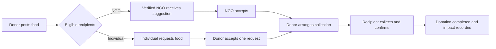
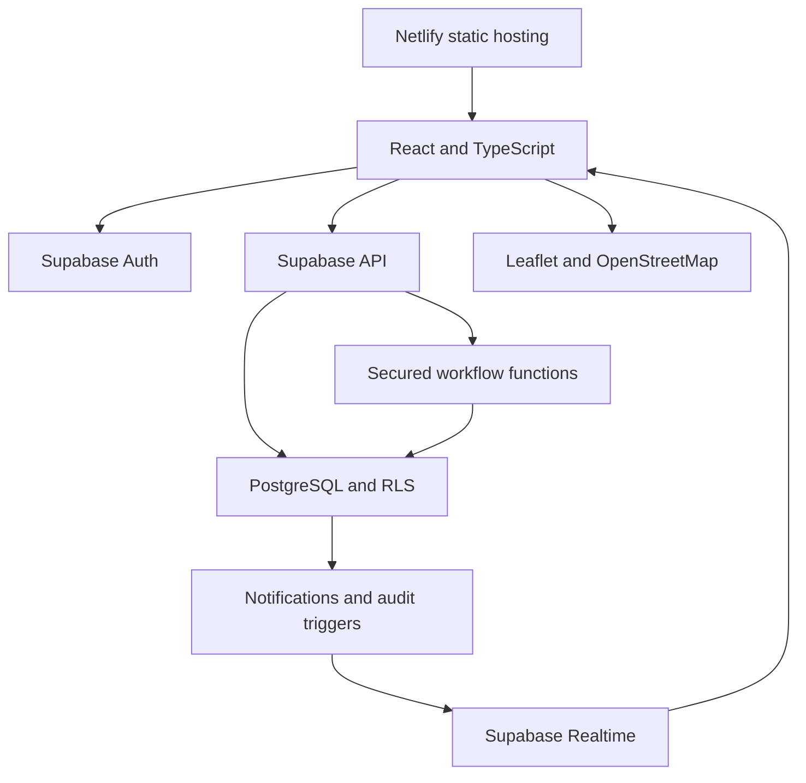
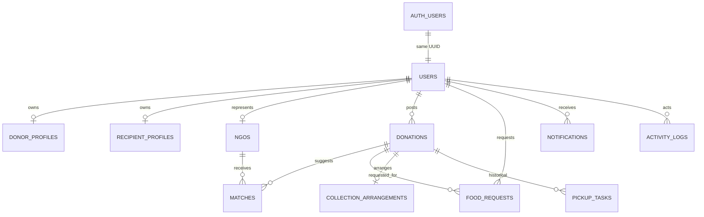

# RescueBite

**Food Rescue & Surplus Redistribution Platform**

[Website](https://rescuebitee.netlify.app/) · [Source](https://github.com/Zeeshan-py/RescueBite) · [Database guide](supabase/README.md)

RescueBite connects surplus-food providers with registered NGOs and individual recipients. A donor posts a time-limited offer, chooses who may receive it, reviews an NGO match or individual request, arranges collection, and receives confirmation. Decisions, notifications, and estimated impact remain traceable.

**Release status:** The recipient redesign in this repository requires the three `20261010` migrations before the frontend is deployed. The linked website may still show the previous release until the database and Netlify build are updated together.

## Why it exists

Food may be discarded while people and community organizations nearby need it. A responsible handover needs food type, portion count, handling information, a realistic deadline, an eligible recipient, limited contact sharing, and confirmed collection. RescueBite coordinates these steps without assuming free delivery.

| Role | What they can do |
| --- | --- |
| **Donor** | Complete a business profile and phone verification, post food, select NGO/individual eligibility, review requests, arrange pickup, and follow outcomes. |
| **NGO** | Maintain organization information, receive suggestions after administrator verification, accept a donation, and confirm collection. |
| **Individual recipient** | Register independently, provide a general area, browse eligible meals, request food, review status and collection details, cancel pending requests, and confirm collection. |
| **Administrator** | Review records, verify NGOs, restrict or restore accounts, cancel unsuitable donations, and inspect audit history. |

Public sign-up offers Donor, NGO, and Individual Recipient. Administrator accounts require trusted provisioning; browser data or Auth metadata cannot grant that role.

## Distribution journey

The donor chooses `NGO_ONLY`, `INDIVIDUAL_ONLY`, or `BOTH`. A verified NGO may accept a suitable suggestion. Individuals first see a listing with general area, food type, portions, and deadline; the exact pickup location and donor contact become available after acceptance. The donor arranges a time and instructions, and the accepted recipient confirms the handover.

**Allocation model:** One donation is reserved for one recipient. A request claims all listed portions. This whole-donation rule fits the original schema; splitting portions among multiple people needs future inventory and partial-fulfilment work. Both acceptance functions lock the donation row. Competing requests or suggestions cannot win the same offer, and a unique index reinforces the one-allocation rule.

Historical `pickup_tasks` and rider events remain for audit. New offers use direct collection and create no volunteer assignment. Pickup is the default. Any separate delivery arrangement must be explicit and is outside the automated workflow.

## Explainable NGO matching

Matching uses deterministic rules, **not generative AI**. A candidate must be verified, accept the food category, have sufficient capacity, and be eligible before the deadline.

| Component | Weight | Basis |
| --- | ---: | --- |
| Distance | 30% | Haversine distance with coordinates; otherwise a documented text-location fallback. |
| Urgency | 25% | Time remaining until collection deadline. |
| Food compatibility | 20% | NGO accepted food categories. |
| Capacity | 15% | Ability to receive the posted portions. |
| Availability | 10% | A baseline because organization schedules are not stored. |

PostgreSQL validates eligibility, score ranges, and the weighted total before storing suggestions. A match score does not certify food safety or guarantee acceptance. Individual browsing is a separate, non-scored path.

## Architecture and data

The frontend uses React 19, TypeScript, Vite, Tailwind CSS, and React Router. Supabase supplies authentication, database, row-level security (RLS), guarded functions, and realtime notifications. Netlify serves the static build and rewrites app routes to `index.html`.

`auth.users` owns credentials; `public.users` holds application identity and role under the same UUID, without passwords. Donor and recipient details live in separate profiles. [`supabase/migrations/`](supabase/migrations/) versions the schema, grants, policies, triggers, and RPCs. Older migrations and rescue history remain intact.

## Security, privacy, and food safety

- RLS limits profiles, requests, donations, matches, notifications, and collection records to authorized participants. React route checks aid navigation; database rules enforce access.
- Public registration can choose only the three non-admin roles. NGO verification and account restrictions are controlled by an administrator and audited.
- Individual meal browsing excludes exact pickup details and donor contact. A matched NGO may view donation details needed for an acceptance decision; donor contact is supplied for an accepted collection.
- Email/phone verification, request quotas, unique allocation, row locks, and guarded state transitions reduce misuse and duplicate claims. Moderation reasons are stored in the audit trail.
- Only public Supabase values may be used as `VITE_` browser variables. `.env` files and `Instruction/` are ignored by Git. Service-role keys and database passwords must never enter the frontend or repository.
- Food and portion counts are donor-reported. Receiving participants remain responsible for suitability and local handling requirements. Read the public [food-safety](https://rescuebitee.netlify.app/food-safety), [privacy](https://rescuebitee.netlify.app/privacy), and [terms](https://rescuebitee.netlify.app/terms) pages.

## Dashboards and impact

Role-specific pages show authorized records and database aggregates. Donors track offers and requests; NGOs track suggestions and collections; individuals track request history; administrators inspect filtered records and moderation activity. Realtime notifications prompt relevant pages to refresh. Reports distinguish when an offer was created from when collection was confirmed.

**Impact is estimated from entered meal portions and recorded confirmations.** The platform does not measure actual consumption, kilograms saved, emissions avoided, or medical outcomes.

## Demo walkthrough

Use a development Supabase project with email confirmation, SMS phone verification for donors, and all migrations applied.

1. Register an NGO, complete its profile, and have an administrator verify it.
2. Register a donor, complete its business profile, verify the phone, and post an offer for NGOs, individuals, or both.
3. For an NGO rescue, generate suggestions and accept as the NGO. For an individual rescue, register a recipient, save a general-area profile, request the food, and approve the request as donor.
4. The donor arranges collection. The accepted recipient opens Collection Details and confirms after the handover.
5. Review notifications, donation status, request history, audit records, and impact reports.

The admin panel lives at `/admin`. Create an administrator through a trusted Supabase administration process with a corresponding `public.users` profile set to `ADMIN`; public registration cannot do this.

## Verification and deployment

Use Node.js 22.18+ on the Node 22 line. Run `npm ci`, set public Supabase values from `.env.example` in ignored `.env.local`, and run `npm test`, `npm run lint`, and `npm run build`. `npm run dev` starts Vite. Build includes TypeScript checking and produces `dist/`.

Apply the three `20261010` migrations **before** deploying this frontend. Review and test them in a separate Supabase project, configure Auth email/SMS and NGO verification, then apply through the Supabase CLI. Netlify builds from the connected repository with public Supabase environment variables. A frontend-only deploy against the old schema will fail. See the [deployment checklist](docs/recipient-redesign.md).

For a disposable local PostgreSQL check, [`scripts/local-auth-bootstrap.sql`](scripts/local-auth-bootstrap.sql) supplies test-only Auth stubs and [`scripts/verify-recipient-schema.sql`](scripts/verify-recipient-schema.sql) exercises RLS and both workflows. Never apply the bootstrap to Supabase. Local checks do **not** prove hosted OAuth, SMS delivery, or deployment.

**Current limits:** Whole-donation allocation does not split portions. The platform does not dispatch transport. Donor phone verification depends on Supabase SMS setup, and NGO verification needs an administrator. Geographic matching uses straight-line distance or text fallback, not route time. Rider workflows are retired but historical records remain. Software does not certify food safety.

See the [database guide](supabase/README.md), [recipient deployment guide](docs/recipient-redesign.md), [OAuth guide](docs/google-sign-in.md), and [security notes](docs/security.md) for details.
