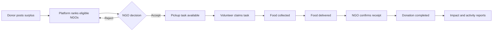
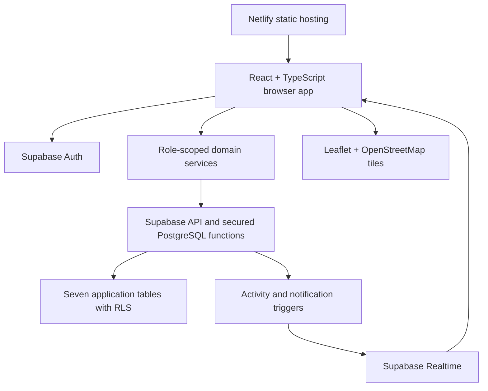
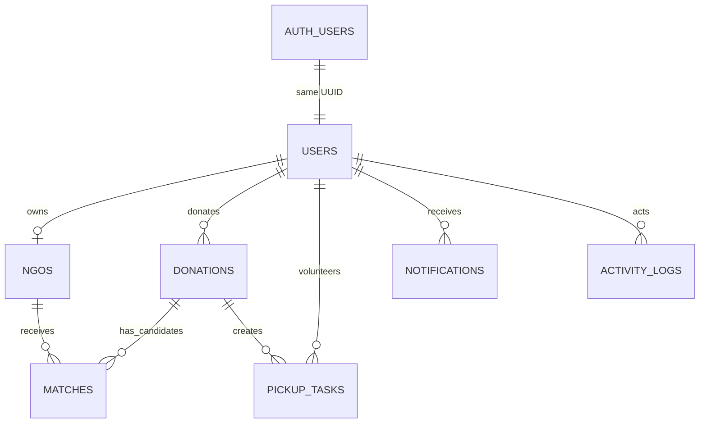

# RescueBite

**Food Rescue & Surplus Redistribution Platform**

[Live website](https://rescuebitee.netlify.app/) · [GitHub repository](https://github.com/Zeeshan-py/RescueBite)

RescueBite connects people with surplus food to NGOs that can receive it and volunteers who can deliver it. A donor posts an offer, the platform recommends suitable NGOs, an NGO accepts, a volunteer completes the pickup, and the NGO confirms receipt. The same records power notifications, accountability, and impact reports.

Built for a Software Engineering Lab project, this is a working end-to-end prototype. It demonstrates coordination; it does not claim that software alone guarantees a real-world food rescue.

## The problem

Surplus food may be discarded while community organizations need it. A useful handover needs more than a listing: participants need food and safety details, location, a collection deadline, a receiving organization, a transporter, and confirmation that the food arrived. RescueBite puts those decisions into one traceable workflow.

| Role | What the workspace provides |
| --- | --- |
| **Donor** | Post and manage donations, generate NGO suggestions, follow progress, and view personal impact. |
| **NGO** | Set up an organization profile, capacity, location, and accepted foods; review suggestions; accept or reject; confirm receipt; view organization impact. |
| **Volunteer** | See available tasks, claim one, record collection and delivery, and review personal activity. |
| **Admin** | Read platform totals, filter and inspect users, donations, NGOs, volunteers, and activity, and view platform analytics. |

Public registration offers donor, NGO, and volunteer accounts. Administrators are provisioned separately.

## The rescue journey



1. **Post:** A donor enters food type, quantity, estimated meal portions, pickup location, availability, collection deadline, and safety information. Optional map coordinates improve distance matching.
2. **Suggest:** Ineligible NGOs are filtered out; eligible ones receive explainable scores. One donation can have several candidates.
3. **Accept:** An NGO decides whether it can receive the food. An atomic database function expires competing suggestions and creates a pickup task. A suggestion is not a food-safety certificate.
4. **Transport:** A volunteer claims the task. Only the assigned volunteer can record collection and delivery.
5. **Confirm:** Delivery and completion are separate. The receiving NGO confirms receipt before the donation becomes complete.
6. **Review:** Recipient-specific notifications and role-scoped reports show the recorded outcome.

The main donation states are `POSTED → MATCHED → ACCEPTED → PICKUP_ASSIGNED → COLLECTED → DELIVERED → COMPLETED`. The database also supports `CANCELLED`, `EXPIRED`, and `EXCEPTION`. Matches and pickup tasks have their own controlled status values.

## Explainable smart matching

Matching uses deterministic rules, **not generative AI**. Eligible NGOs must accept the food category, have sufficient capacity for the estimated portions, and be within the collection deadline.

| Component | Weight | Meaning |
| --- | ---: | --- |
| Distance | 30% | Haversine distance when both places have coordinates; otherwise a documented text-location fallback. |
| Urgency | 25% | Less time until the deadline yields a higher score; past-deadline donations are ineligible. |
| Food compatibility | 20% | Whether the NGO accepts the donation's food category. |
| Capacity | 15% | Whether the NGO has enough capacity, with headroom rewarded. |
| Availability | 10% | A fixed baseline because volunteer schedules are not recorded. |

**Total =** `0.30 × distance + 0.25 × urgency + 0.20 × compatibility + 0.15 × capacity + 0.10 × availability`.

If coordinates are missing, identical normalized location text scores 100 for the distance component and other text scores 50. That fallback is **not** a physical distance estimate. Score components are visible for review. The database validates ownership, compatibility, capacity, score bounds, and the weighted total before storing candidates.

## Architecture



The frontend uses **React 19, TypeScript, Vite, Tailwind CSS, and React Router**. Supabase supplies authentication, PostgreSQL, secured database functions, and realtime updates. Leaflet displays OpenStreetMap maps; geographic scoring uses the Haversine formula when coordinates exist. Netlify serves the static build and rewrites direct application routes to `index.html`.

Important workflow transitions run through guarded database functions rather than trusting direct browser status updates. Row locks prevent competing acceptance or task-claim requests from both succeeding. Notifications are written in the same transaction as successful transitions; realtime refreshes visible statuses.

### Data relationships



`auth.users` owns authentication; `public.users` stores profile information under the same UUID and never stores passwords. Seven application tables hold users, NGOs, donations, matches, pickup tasks, notifications, and activity logs. The schema and later workflow/security changes are versioned in [`supabase/migrations/`](supabase/migrations/). See the [database guide](supabase/README.md).

## Security and privacy

- **Row Level Security (RLS)** protects every application table. Participants can access their own records or those needed for their authorized workflow; ordinary users cannot browse admin logs.
- PostgreSQL validates roles and statuses. Frontend route guards help navigation, while database policies and secured functions enforce access.
- Critical actions check role, ownership, deadline, and current state. The browser does not need a service-role key or database password.
- Notifications are recipient-specific. Realtime uses the same row permissions.
- `.env`, `.env.*` (except `.env.example`), and the private `Instruction/` folder are ignored by Git. Only public Supabase configuration belongs in `VITE_` variables, which are visible to browsers.
- Google sign-in UI uses Supabase OAuth. Its availability depends on external Google/Supabase provider settings; see the [OAuth guide](docs/google-sign-in.md).

Public [privacy](https://rescuebitee.netlify.app/privacy), [terms](https://rescuebitee.netlify.app/terms), and [food safety](https://rescuebitee.netlify.app/food-safety) pages explain data use and participant responsibilities. Receiving organizations remain responsible for assessing food condition and applying local handling requirements.

## Dashboards, locations, and impact

Each participant dashboard displays real database aggregates and recent records. The admin workspace offers read-only records with server-side filters and pagination. Maps display donation, NGO, and pickup locations when coordinates are present; written addresses remain available otherwise.

Role-based analytics cover donation creation and status, matching and acceptance, pickup and delivery, completed estimated portions, and time trends. Reports distinguish the date a donation was **created** from the date it was **completed**. SQL aggregation happens in PostgreSQL, so the browser does not download the whole dataset to compute platform totals. See [metric definitions](docs/analytics.md).

**Impact is estimated from entered meal portions and recorded events.** The system does not measure kilograms rescued, emissions avoided, actual meals consumed, or individual recipients. This README intentionally reports no invented impact totals.

## Demo walkthrough

Open the [live app](https://rescuebitee.netlify.app/). A full walkthrough uses separate donor, NGO, and volunteer accounts; admin access is provisioned separately.

1. Register an **NGO**, then complete its profile with an accepted food category and enough capacity.
2. Register a **donor**, post a donation of that category with a future deadline, then generate and review suggestions.
3. Sign in as the **NGO** and accept the suggestion.
4. Sign in as a **volunteer**, claim the available task, then record collection and delivery.
5. Return to the **NGO** to confirm receipt. Inspect the completed donation, notifications, and analytics.

Use test descriptions and locations for a software demonstration. Matching requires an eligible NGO to exist when suggestions are generated. Google login may require an allowed test account while its OAuth consent screen is in testing.

## Administrator access

The admin panel is at [`/admin`](https://rescuebitee.netlify.app/admin). It requires an authenticated account whose **`public.users.role` is `ADMIN`**. Admin is intentionally absent from public registration and cannot be gained by editing the browser or Auth metadata.

To provision a dedicated administrator, register a **separate** donor account through the website and confirm its email. In the Supabase project's SQL Editor, while signed in as the project owner, replace the address below with that new account's email and run:

```sql
update public.users
set role = 'ADMIN'
where email = 'new-admin-account@example.com'
  and role = 'DONOR'
returning email, role;
```

Confirm that exactly one row is returned with `ADMIN`. Then sign out of that account and sign in again. Open `/admin`, or use the Admin navigation shown after sign-in. Keep the original donor account separate if you need to demonstrate donor actions. The panel provides read-only operational records and analytics; it does not offer an admin sign-up or full record editing interface.

## Run and verify locally

Use **Node.js 22.18.0 or a later Node 22 release** (`.nvmrc`). From the repository root:

```sh
npm ci
```

Copy `.env.example` to `.env.local` and set `VITE_SUPABASE_URL` and `VITE_SUPABASE_ANON_KEY` to your project's **public** values. Do not put a service-role key or database password in frontend settings. Then:

```sh
npm run dev
npm test
npm run lint
npm run build
```

Vite normally serves the site at `http://127.0.0.1:5173`. Build runs TypeScript checks and writes `dist/`. Migration commands and database setup are in the [database guide](supabase/README.md). Live integration scripts under `scripts/` need an authorized test project; a passing local build alone does not prove external OAuth or hosting settings.

## Repository map

| Path | Purpose |
| --- | --- |
| `src/auth/` | Session, profile, role, and route access. |
| `src/pages/` | Public and role-specific workspaces. |
| `src/components/` | Layout, forms, maps, notifications, progress, and status UI. |
| `src/services/` | Donations, matching, workflow, dashboards, analytics, and realtime. |
| `src/types/domain.ts` | Shared entities and status types. |
| `supabase/migrations/` | Versioned PostgreSQL schema, RLS, functions, and triggers. |
| `scripts/` | Targeted live verification and temporary test fixtures. |
| `docs/` | Analytics, security, OAuth, and accessibility details. |
| `public/_redirects` | Netlify route-refresh rewrite. |

## Validation and known limits

The Phase 14 validation recorded **134 passing unit/component tests**, passing lint and production build, and **127 live security/workflow checks** using temporary data that was removed afterward. The production bundle also rendered locally in headless Chrome. See the [security audit](docs/security.md) and [UI/accessibility report](docs/ui-accessibility.md) for exact coverage.

Current limits: volunteer availability is a baseline rather than a schedule; matching does not certify food safety; map-point selection requires a pointer (text entry is available); reported portions are estimates; and Google login depends on provider settings. Browser visual and keyboard checks across all roles are incomplete, so no formal accessibility certification is claimed.

## Links

- [Live app](https://rescuebitee.netlify.app/)
- [Source code](https://github.com/Zeeshan-py/RescueBite)
- [About](https://rescuebitee.netlify.app/about) · [FAQ](https://rescuebitee.netlify.app/faq) · [Contact](https://rescuebitee.netlify.app/contact)
